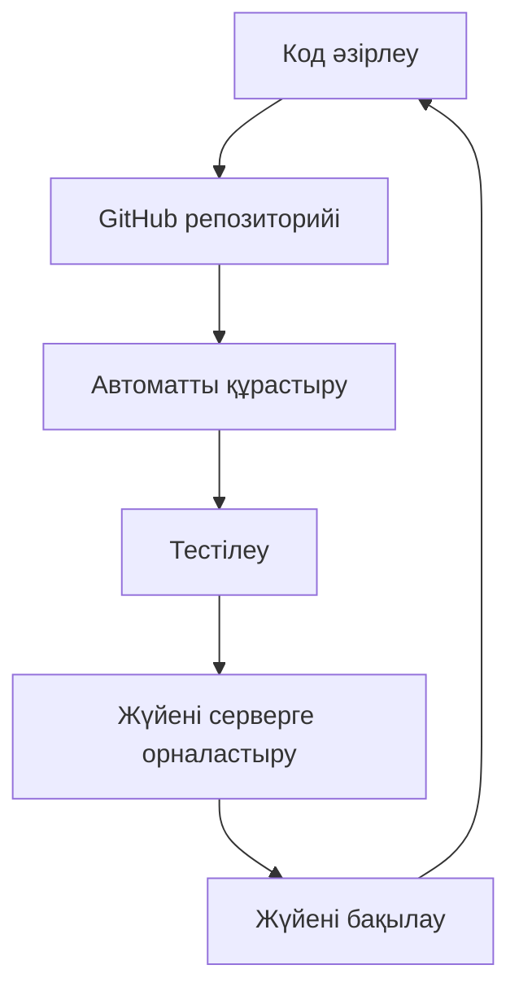

# AquaWash — Автокөлік жуу орнын және кезекті басқару жүйесі

## 1-тапсырма. DevOps процесін жобалау

**Жобаның мақсаты:** Автокөлік жуу орнындағы клиенттерді тіркеу, кезекті басқару және қызмет көрсету процестерін автоматтандыру.

### DevOps процесінің схемасы

### Кезеңдердің сипаттамасы

1. **Код әзірлеу:** Клиентті тіркеу, қызмет таңдау және кезекті басқару функциялары жасалады.
2. **GitHub:** Бағдарламалық код GitHub репозиторийіне сақталады.
3. **Build:** Жүйенің бағдарламалық бөліктері автоматты түрде құрастырылады.
4. **Test:** Клиентті тіркеу, кезекке қосу және қызмет таңдау функциялары тексеріледі.
5. **Deploy:** Дайын жүйе серверге орналастырылады.
6. **Monitor:** Жүйенің жұмысы мен қателері бақыланады.

**Нәтиже:** DevOps жүйені жаңартуды жеңілдетеді, қателерді ерте анықтауға және бағдарламаны пайдаланушыларға жылдам жеткізуге мүмкіндік береді.
