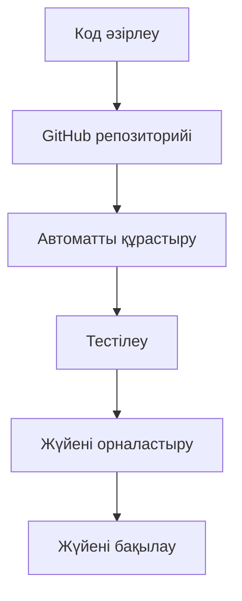

# AquaWash

## 1-тапсырма. DevOps процесін жобалау

**Жоба:** Автокөлік жуу орнын және кезекті басқару жүйесі.

### DevOps процесінің схемасы

### Кезеңдердің сипаттамасы

1. **Код әзірлеу:** Клиентті тіркеу, қызмет таңдау, кезекті басқару функциялары жасалады
2. **GitHub:** Бағдарламалық код Git репозиторийіне сақталады
3. **Build:** Жүйе автоматты түрде құрастырылады
4. **Test:** Клиентті тіркеу және кезекке қосу функциялары тексеріледі
5. **Deploy:** Дайын жүйе серверге орналастырылады
6. **Monitor:** Жүйенің жұмысы мен қателері бақыланады
